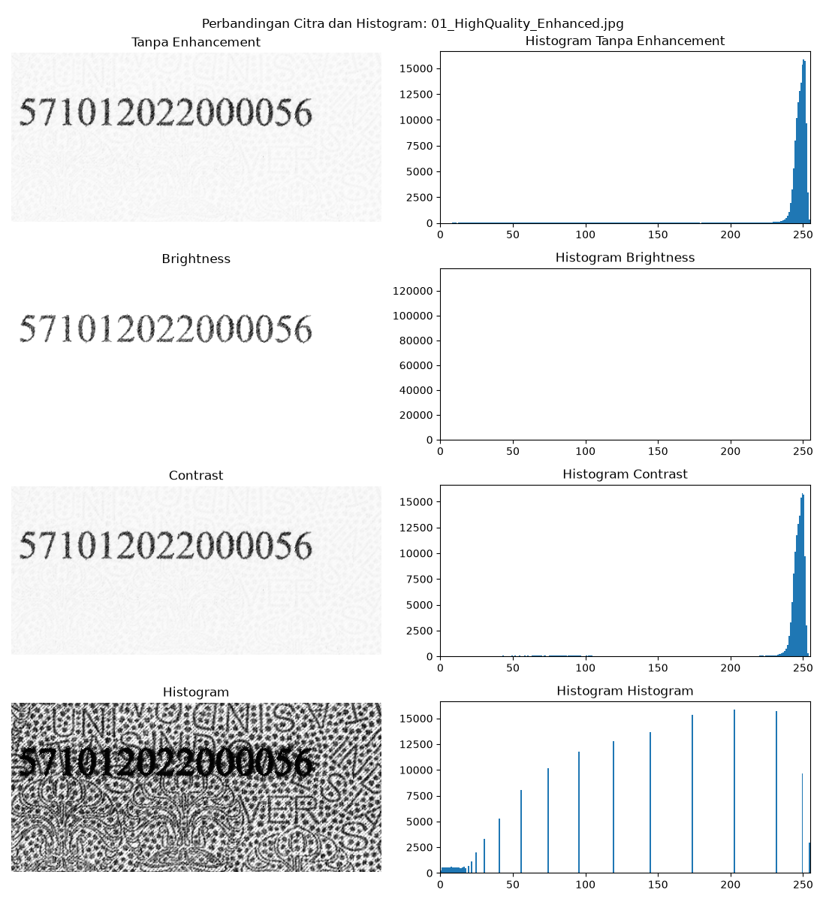
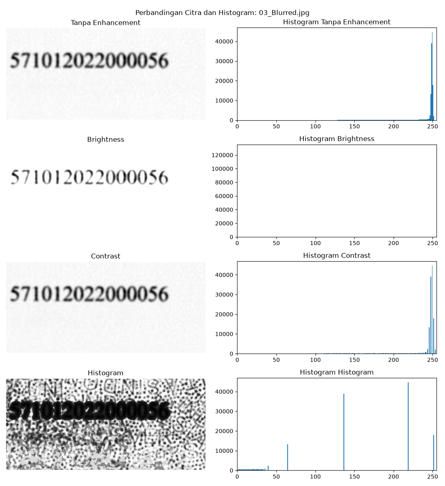
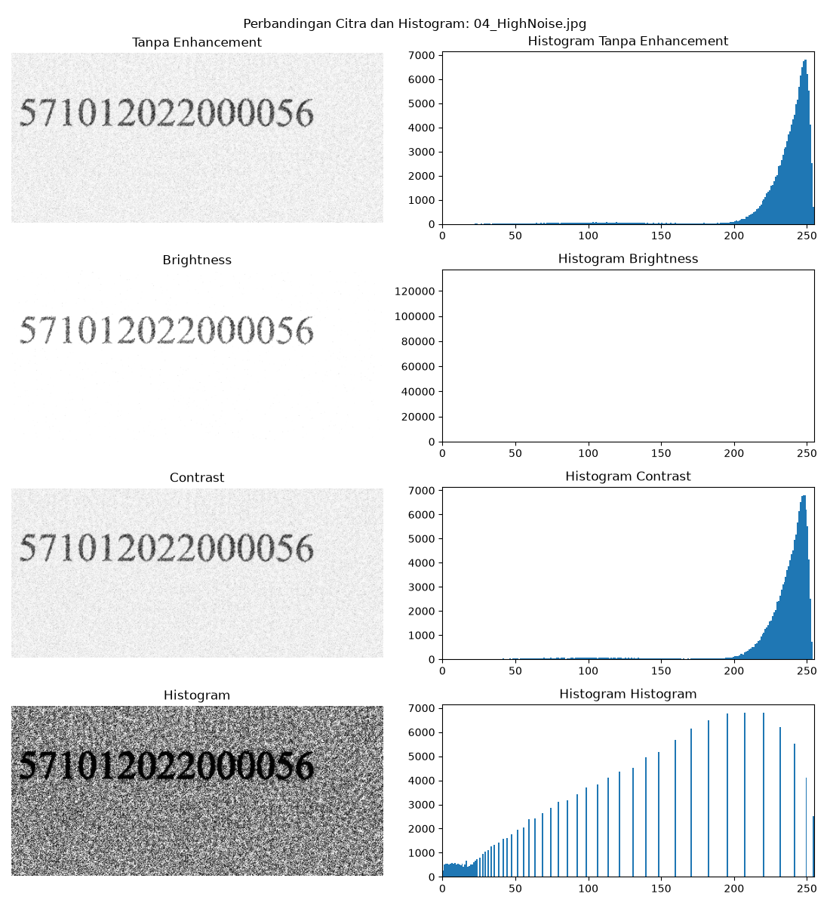
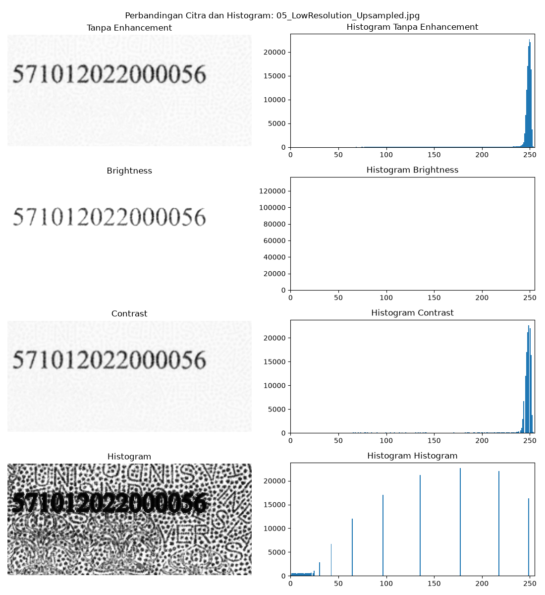
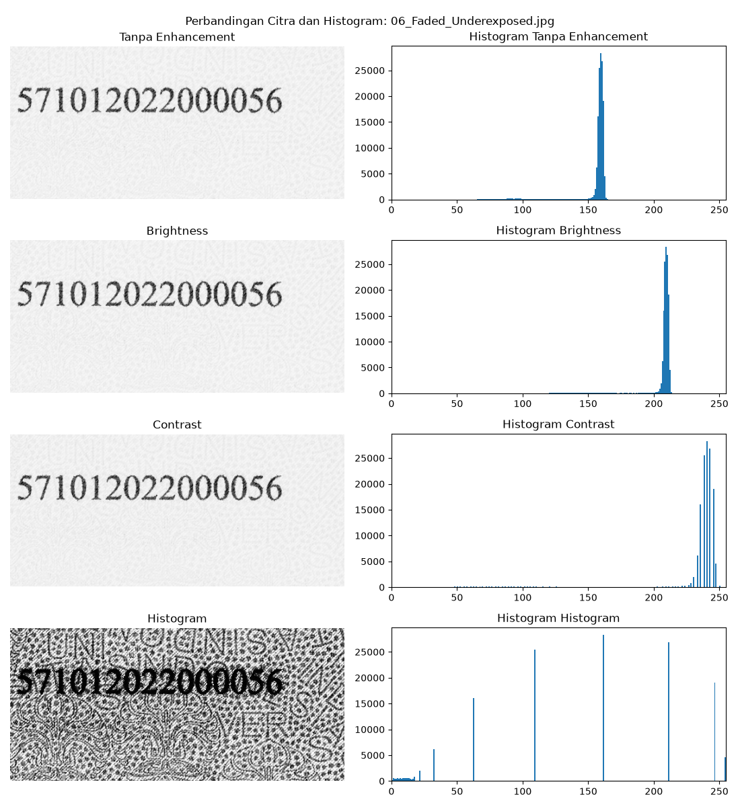
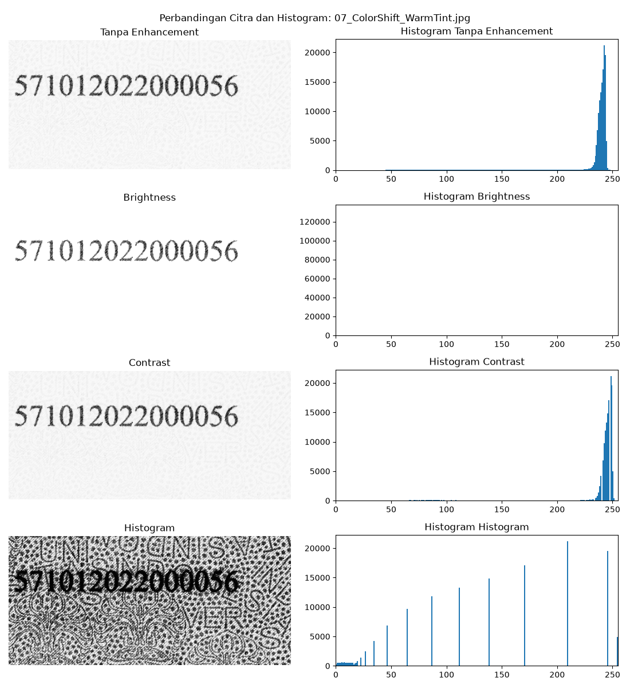
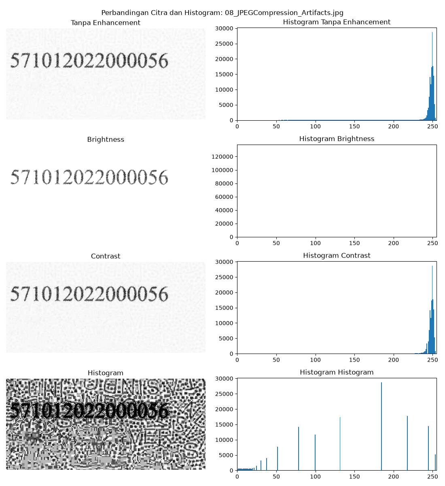
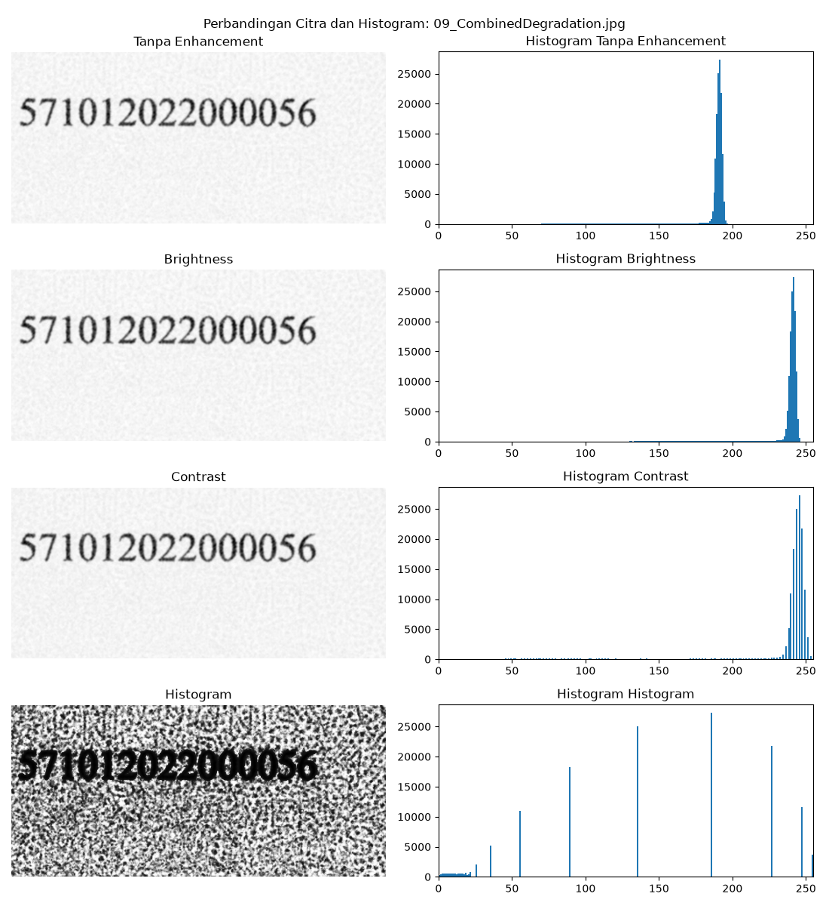

# Tugas 04 — Enhancement Nomor Ijazah untuk OCR

## Deskripsi

Proyek ini membandingkan tiga metode peningkatan citra pada area nomor ijazah
dan mengukur pengaruhnya terhadap hasil *Optical Character Recognition* (OCR).
Area nomor dipotong sebagai ROI, diubah menjadi grayscale, lalu diproses
menggunakan Brightness, Contrast, dan Histogram Equalization. Hasil OCR setiap
metode dibandingkan dengan nomor referensi menggunakan Character Error Rate
(CER).

## Tujuan

- Membandingkan citra nomor ijazah sebelum dan sesudah enhancement.
- Mengamati perubahan histogram intensitas untuk setiap metode.
- Mengukur ketepatan OCR menggunakan CER.
- Menentukan metode yang paling sesuai berdasarkan hasil eksperimen.

## Teknologi yang Digunakan

- Python
- OpenCV (`cv2`)
- NumPy
- Matplotlib
- pytesseract dan Tesseract OCR
- pandas

## Struktur Folder

```text
Tugas04/
├── gambar_ijazah/
│   └── *.jpg, *.jpeg, *.png, *.bmp, *.tif, *.tiff
├── output_folder/
│   ├── enhancement/
│   ├── histogram/
│   ├── perbandingan/
│   ├── perbandingan_ketiga_metode.csv
│   └── kesimpulan_metode_terbaik.csv
├── enhancement_nomor_ijazah.py
├── materi.md
└── README.md
```

- `gambar_ijazah/` — gambar masukan; proyek ini menyertakan sembilan gambar
  dengan kondisi kualitas yang berbeda.
- `output_folder/enhancement/` — citra hasil Brightness, Contrast, dan
  Histogram Equalization.
- `output_folder/histogram/` — histogram masing-masing citra sebelum dan
  sesudah enhancement.
- `output_folder/perbandingan/` — gambar gabungan yang menampilkan citra dan
  histogram sebelum serta sesudah enhancement.
- `perbandingan_ketiga_metode.csv` — hasil OCR dan CER untuk baseline dan
  setiap metode.
- `kesimpulan_metode_terbaik.csv` — metode enhancement dengan CER terendah
  untuk setiap gambar. Baseline tidak ikut dipilih sebagai metode enhancement.

## Metode Pengolahan

1. **Grayscale Conversion** — mengubah ROI ke satu kanal intensitas.
2. **Brightness** — menambah nilai kecerahan sebesar 50.
3. **Contrast Stretching** — memetakan intensitas minimum dan maksimum ROI
   menjadi rentang 0–255.
4. **Histogram Equalization** — meratakan distribusi intensitas menggunakan
   `cv2.equalizeHist`.
5. **OCR** — Tesseract dijalankan dengan mode satu baris (`--psm 7`) dan
   whitelist angka (`0123456789`).
6. **Evaluasi CER** — membandingkan hasil OCR dengan nomor referensi
   `571012022000056`. CER 0% berarti hasil OCR cocok persis dengan referensi.

## Hasil Eksperimen

Ringkasan berikut diambil dari `output_folder/perbandingan_ketiga_metode.csv`.
Setiap angka menunjukkan CER dalam persen; semakin kecil nilainya, semakin
sedikit kesalahan karakter.

| Gambar | Tanpa enhancement | Brightness | Contrast | Histogram Equalization | Hasil terbaik di antara enhancement |
|---|---:|---:|---:|---:|---|
| `01_HighQuality_Enhanced.jpg` | 0.00% | 0.00% | 0.00% | 100.00% | Brightness dan Contrast (seri) |
| `02_LowContrast.jpg` | 0.00% | 0.00% | 0.00% | 100.00% | Brightness dan Contrast (seri) |
| `03_Blurred.jpg` | 0.00% | 6.67% | 0.00% | 100.00% | Contrast |
| `04_HighNoise.jpg` | 0.00% | 0.00% | 0.00% | 100.00% | Brightness dan Contrast (seri) |
| `05_LowResolution_Upsampled.jpg` | 0.00% | 0.00% | 0.00% | 100.00% | Brightness dan Contrast (seri) |
| `06_Faded_Underexposed.jpg` | 0.00% | 0.00% | 0.00% | 100.00% | Brightness dan Contrast (seri) |
| `07_ColorShift_WarmTint.jpg` | 0.00% | 0.00% | 0.00% | 100.00% | Brightness dan Contrast (seri) |
| `08_JPEGCompression_Artifacts.jpg` | 0.00% | 0.00% | 0.00% | 100.00% | Brightness dan Contrast (seri) |
| `09_CombinedDegradation.jpg` | 0.00% | 0.00% | 0.00% | 100.00% | Brightness dan Contrast (seri) |

Pada delapan gambar, Brightness dan Contrast sama-sama mencapai CER 0%.
Pada gambar buram, Contrast memperoleh CER 0%, sedangkan Brightness memperoleh
6.67% karena satu karakter hilang dari hasil OCR. Histogram Equalization
menghasilkan OCR kosong pada sembilan gambar (CER 100%). Baseline tanpa
enhancement juga memperoleh CER 0% pada seluruh gambar yang diuji.

### Perbandingan citra dan histogram

Setiap gambar berikut memperlihatkan ROI sebelum enhancement, hasil ketiga
metode, serta histogram masing-masing citra.

| Gambar | Citra dan histogram sebelum/sesudah |
|---|---|
| High quality |  |
| Low contrast |  |
| Blurred |  |
| High noise |  |
| Low resolution |  |
| Faded/underexposed |  |
| Warm color shift |  |
| JPEG artifacts |  |
| Combined degradation |  |

### Metode mana yang menghasilkan citra paling baik untuk OCR?

Berdasarkan eksperimen ini, **Contrast merupakan pilihan paling konsisten di
antara metode enhancement**: CER-nya 0% pada semua sembilan gambar dan menjadi
satu-satunya metode enhancement dengan CER 0% pada gambar buram. Namun,
Brightness juga seri dengan Contrast pada delapan gambar lainnya. Jadi hasil
eksperimen tidak menunjukkan bahwa Contrast selalu mengungguli Brightness.

Histogram Equalization menjadi metode terburuk pada kumpulan gambar ini karena
OCR tidak mengenali angka pada hasilnya. Perlu dicatat bahwa citra tanpa
enhancement juga memperoleh CER 0% pada semua sampel. Dengan demikian,
enhancement tidak meningkatkan skor OCR dibanding baseline pada data ini;
kesimpulan “terbaik” di atas hanya membandingkan tiga metode enhancement yang
diminta.

## Analisis dan Jawaban

### Mengapa peningkatan contrast dapat membantu OCR mengenali karakter nomor ijazah?

Contrast stretching memperluas rentang intensitas pada ROI: piksel tergelap
didekatkan ke hitam dan piksel paling terang didekatkan ke putih. Jika angka
dan latar memiliki intensitas yang berdekatan, pemisahan tersebut dapat
membuat tepi serta bentuk karakter lebih jelas. OCR lalu lebih mudah
membedakan karakter dari latar belakang.

Pada eksperimen ini, Contrast menghasilkan CER 0% untuk semua gambar dan
membantu mempertahankan pengenalan angka pada gambar buram, sementara
Brightness kehilangan satu karakter pada gambar tersebut. Meski begitu,
baseline juga memperoleh CER 0% untuk semua gambar, sehingga data ini
menunjukkan bahwa Contrast tidak menurunkan akurasi OCR di sampel yang diuji,
bukan bukti bahwa contrast selalu meningkatkan akurasi.

### Apakah Histogram Equalization selalu menjadi metode terbaik?

**Tidak.** Histogram Equalization mendistribusikan ulang intensitas global,
tetapi pemerataan histogram tidak otomatis membuat batas karakter dan latar
lebih mudah dibaca. Pada ROI dalam eksperimen ini terdapat tekstur/pola latar;
equalization membuat pola tersebut tampak kuat bersama karakter. Hasilnya
kurang sesuai untuk OCR: keluaran OCR kosong dan CER mencapai 100% pada
kesembilan gambar. Sebaliknya, Contrast memperoleh CER 0% pada kesembilan
gambar.

Karena itu, pemilihan enhancement perlu didasarkan pada tampilan hasil dan
ukuran objektif seperti CER, bukan pada histogram yang tampak lebih merata
saja. Hasil ini khusus untuk gambar, ROI, parameter, dan konfigurasi Tesseract
yang digunakan; gambar lain dapat memberikan hasil berbeda.

## Cara Menjalankan Program

1. Pasang Python dan Tesseract OCR, lalu instal dependensi Python:

   ```bash
   pip install opencv-python numpy pytesseract pandas matplotlib
   ```

2. Pastikan path executable Tesseract pada `enhancement_nomor_ijazah.py`
   sesuai dengan instalasi komputer. Skrip saat ini menggunakan:
   `C:\Program Files\Tesseract-OCR\tesseract.exe`.
3. Letakkan gambar masukan di `gambar_ijazah/`.
4. Jalankan dari folder `Tugas04/`:

   ```bash
   python enhancement_nomor_ijazah.py
   ```

5. Periksa gambar dan file CSV di `output_folder/`.

Program memilih ROI menggunakan koordinat relatif tetap pada gambar. Pastikan
nomor ijazah berada di area tersebut agar proses OCR dan evaluasi CER sesuai.

## Kesimpulan

Eksperimen membandingkan Brightness, Contrast, dan Histogram Equalization
menggunakan histogram visual dan CER OCR. Contrast menjadi metode enhancement
paling konsisten pada sembilan sampel, sedangkan Histogram Equalization gagal
mengenali angka pada set ini. Namun, karena baseline pun menghasilkan CER 0%
untuk seluruh sampel, hasil ini tidak membuktikan bahwa enhancement selalu
diperlukan atau bahwa satu metode akan terbaik untuk semua citra.