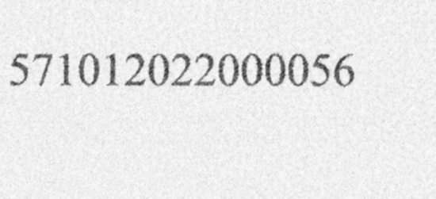
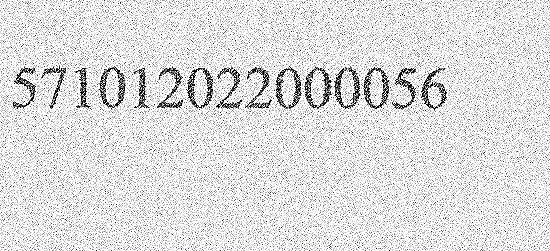

# Tugas 05 — Perbandingan Filter Citra untuk OCR Nomor Ijazah

## Deskripsi

Proyek ini membandingkan pengaruh beberapa filter citra terhadap pengenalan
nomor ijazah menggunakan *Optical Character Recognition* (OCR). Program
mengambil ROI nomor ijazah dari setiap gambar, mengubahnya menjadi grayscale,
menerapkan filter, lalu menggunakan hasil setiap metode sebagai masukan OCR.
Hasil pengenalan dibandingkan dengan nomor referensi untuk menghitung jumlah
karakter yang benar dan akurasi.

## Tujuan

- Membandingkan citra original dengan hasil Mean, Median, Gaussian, dan
  Sharpening Filter.
- Menguji hasil filter sebagai masukan OCR.
- Membandingkan teks OCR, jumlah karakter yang benar, dan akurasi setiap
  metode.
- Mengamati manfaat dan keterbatasan filter pada citra dengan kondisi berbeda.

## Teknologi

- Python
- OpenCV (`cv2`)
- NumPy
- pytesseract dan Tesseract OCR

## Struktur Folder

```text
Tugas05/
├── gambar_ijazah/
│   └── *.jpg, *.jpeg, *.png
├── filtered_ijazah/
│   └── *_Original.jpg
│       *_Mean_Filter.jpg
│       *_Median_Filter.jpg
│       *_Gaussian_Filter.jpg
│       *_Sharpening.jpg
├── enhancement_untuk _ocr.py
└── README.md
```

- `gambar_ijazah/` — sembilan citra masukan dengan kualitas/kondisi yang
  bervariasi.
- `filtered_ijazah/` — citra grayscale original dan hasil masing-masing filter.
  Program membuat folder ini dan menyimpan citra hasil saat dijalankan.
- `enhancement_untuk _ocr.py` — skrip pemrosesan filter dan evaluasi OCR.

## Metode Pengolahan dan OCR

1. Program mengambil area nomor ijazah berdasarkan koordinat relatif pada
   gambar, lalu mengubah ROI menjadi grayscale.
2. Lima citra yang dibandingkan adalah:
   - **Original** — grayscale tanpa filter.
   - **Mean Filter** — perataan lokal dengan kernel 3×3 (`cv2.blur`).
   - **Median Filter** — median lokal dengan kernel 3×3
     (`cv2.medianBlur`).
   - **Gaussian Filter** — penghalusan dengan Gaussian Blur 3×3
     (`cv2.GaussianBlur`).
   - **Sharpening** — penajaman menggunakan kernel
     `[[0,-1,0],[-1,5,-1],[0,-1,0]]`.
3. Setiap citra metode diperbesar 4×, diubah ke biner dengan threshold Otsu,
   lalu dikirim ke Tesseract sebagai satu baris angka. OCR dibatasi ke digit
   0–9.
4. Hasil OCR dibandingkan terhadap ground truth `571012022000056`, yang
   terdiri dari 15 karakter.

### Perbandingan visual

Contoh citra untuk kasus `04_HighNoise` dapat dilihat pada berkas hasil filter:

| Metode | Hasil |
|---|---|
| Original |  |
| Mean Filter |  |
| Median Filter |  |
| Gaussian Filter |  |
| Sharpening |  |

Gambar-gambar tersebut merupakan ROI hasil filter sebelum tahap pembesaran
dan threshold Otsu yang digunakan sebagai masukan OCR.

## Hasil OCR

Skrip menampilkan tabel OCR untuk **setiap gambar** di terminal, dengan satu
baris per metode. Kolom `Karakter Benar` dihitung dengan membandingkan
karakter berdasarkan posisinya terhadap ground truth; `Akurasi` adalah
jumlah karakter yang cocok dibagi 15, dikali 100%.

| Metode | Hasil OCR | Karakter Benar | Akurasi |
|---|---|---:|---:|
| Original | Lihat hasil OCR yang dicetak skrip untuk setiap gambar | —/15 | —% |
| Mean Filter | Lihat hasil OCR yang dicetak skrip untuk setiap gambar | —/15 | —% |
| Median Filter | Lihat hasil OCR yang dicetak skrip untuk setiap gambar | —/15 | —% |
| Gaussian Filter | Lihat hasil OCR yang dicetak skrip untuk setiap gambar | —/15 | —% |
| Sharpening | Lihat hasil OCR yang dicetak skrip untuk setiap gambar | —/15 | —% |

**Catatan:** folder proyek yang tersedia berisi citra hasil filter, tetapi
tidak berisi log atau CSV hasil OCR. Karena itu, angka OCR dan akurasi tidak
dicantumkan di tabel ini agar tidak mengarang hasil eksperimen. Jalankan
skrip untuk memperoleh nilai aktual; tabel rinci setiap gambar dan metode
akan dicetak ke terminal. Ringkasan rata-rata akurasi per metode juga dicetak
di akhir proses, tetapi saat ini tidak disimpan ke file.

## Analisis dan Jawaban

### Mengapa Median Filter dapat memberikan hasil OCR yang lebih baik pada citra dengan salt-and-pepper noise?

Salt-and-pepper noise muncul sebagai piksel-piksel acak yang sangat terang
(“salt”) atau sangat gelap (“pepper”). Median Filter mengganti nilai piksel
dengan median nilai tetangganya. Nilai ekstrem yang menyimpang biasanya
tersisih dari median, sehingga noise impulsif dapat dikurangi tanpa
mengaburkan tepi karakter sebanyak filter perataan seperti Mean atau Gaussian.
Kontur angka yang lebih terjaga dapat membantu tahap threshold dan OCR
membedakan bentuk digit.

Keuntungan ini bergantung pada ukuran dan kepadatan noise serta kernel yang
digunakan. Filter median yang terlalu kuat dapat menghapus detail atau bagian
tipis karakter; karena itu hasil OCR tetap perlu dibandingkan, bukan hanya
dinilai dari tampilan.

### Apakah citra yang paling bagus secara visual selalu menghasilkan OCR dengan akurasi tertinggi?

**Tidak selalu.** Penilaian visual dan OCR tidak identik. Citra yang terlihat
lebih halus atau lebih tajam bagi manusia belum tentu mempertahankan fitur
yang dibutuhkan OCR. Penghalusan berlebih dapat menghilangkan garis tipis
digit, sedangkan sharpening dapat memperkuat noise atau membuat karakter
menyatu. Thresholding, ukuran karakter, kontras, dan parameter OCR juga
mempengaruhi pengenalan.

Dalam eksperimen ini, perbandingan yang menentukan adalah teks hasil OCR dan
akurasi karakter untuk setiap metode pada setiap gambar. Citra paling baik
untuk OCR adalah citra yang menghasilkan akurasi tertinggi menurut pengukuran
tersebut, bukan semata-mata yang tampak paling bersih. Jika beberapa metode
memiliki akurasi seri, pertimbangkan pula keterbacaan dan artefak sebelum
memilih metode.

## Cara Menjalankan

1. Instal Python, Tesseract OCR, serta dependensi Python:

   ```bash
   pip install opencv-python numpy pytesseract
   ```

2. Periksa bahwa path Tesseract pada skrip sesuai instalasi komputer. Nilai
   bawaan skrip adalah `C:\Program Files\Tesseract-OCR\tesseract.exe`.
3. Letakkan gambar masukan di folder `gambar_ijazah/`.
4. Buka terminal pada folder `Tugas05/`, lalu jalankan:

   ```bash
   python "enhancement_untuk _ocr.py"
   ```

5. Baca hasil tabel OCR dan ringkasan akurasi rata-rata di terminal, serta
   periksa citra hasil pada `filtered_ijazah/`.

Pastikan nomor ijazah berada di area yang dipotong oleh koordinat ROI pada
skrip. Koordinat tersebut tetap, sehingga gambar dengan tata letak berbeda
mungkin memerlukan penyesuaian.

## Kesimpulan

Program menguji Original, Mean Filter, Median Filter, Gaussian Filter, dan
Sharpening sebagai masukan OCR, lalu membandingkan kecocokan karakter dengan
nomor referensi. Median Filter secara teori sesuai untuk mengurangi
salt-and-pepper noise sambil menjaga tepi, tetapi metode terbaik pada data
nyata perlu ditentukan dari nilai OCR dan akurasi per gambar. Tampilan visual
saja belum cukup untuk menyimpulkan kualitas OCR.
