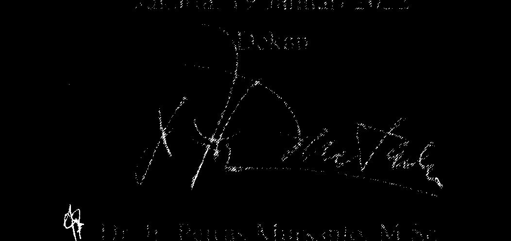
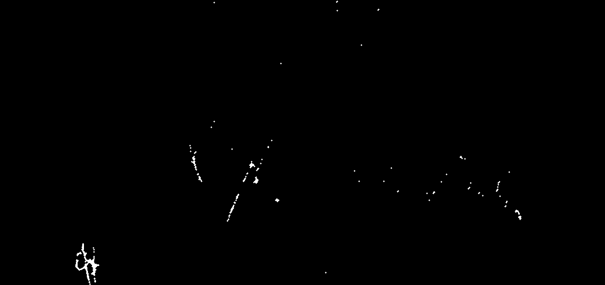
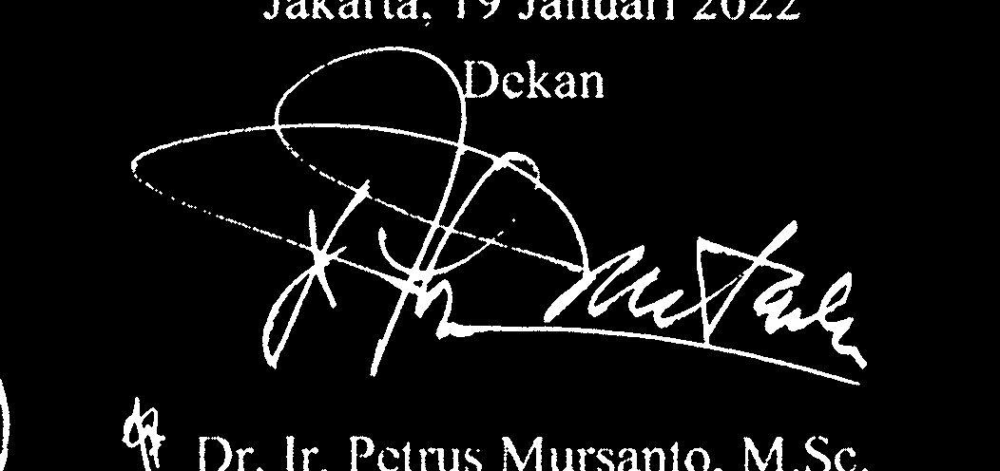
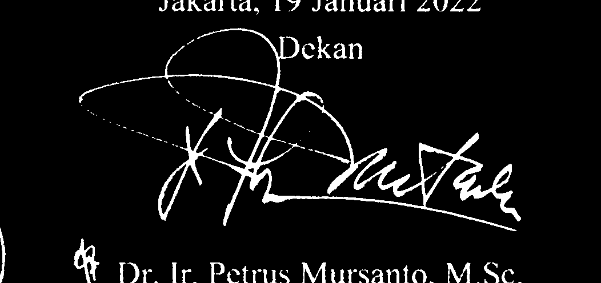
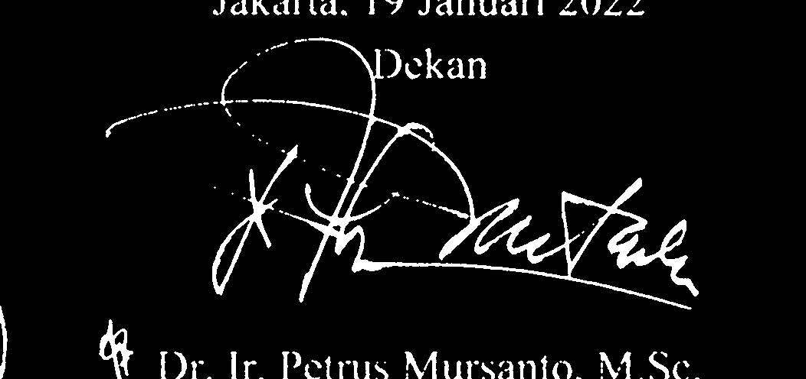

# Tugas 06 — Deteksi Keberadaan Tanda Tangan

## Deskripsi

Program ini memperkirakan keberadaan tanda tangan pada area ijazah dengan
pengolahan citra berbasis aturan. Citra dipotong ke area yang ditentukan,
diubah menjadi grayscale, lalu diproses menggunakan dua metode thresholding:
Global Threshold dan Otsu Thresholding. Hasil biner dibersihkan dengan
morphological opening dan closing. Program menghitung jumlah piksel foreground
dan rasio foreground untuk menghasilkan salah satu status:

- `SIGNATURE PRESENT`
- `SIGNATURE ABSENT`

Hasil merupakan perkiraan berdasarkan area ROI dan ambang rasio, bukan
verifikasi pasti bahwa tanda tangan ada.

## Tujuan

- Membandingkan hasil Global Threshold dan Otsu Thresholding.
- Menerapkan morphological opening dan closing pada citra biner.
- Menghitung piksel foreground dan rasio foreground pada ROI.
- Menentukan status keberadaan tanda tangan dengan aturan sederhana.
- Menganalisis pengaruh nilai threshold terhadap hasil segmentasi.

## Teknologi

- Python
- OpenCV (`cv2`)
- NumPy

## Struktur Folder

```text
Tugas06/
├── gambar_ijazah/
│   └── 01_HighQuality_Enhanced.jpg
│       02_LowContrast.jpg
│       03_Blurred.jpg
│       04_HighNoise.jpg
│       05_LowResolution_Upsampled.jpg
│       06_Faded_Underexposed.jpg
│       07_ColorShift_WarmTint.jpg
│       08_JPEGCompression_Artifacts.jpg
│       09_CombinedDegradation.jpg
├── hasil_ttd/
│   └── *_Global_gray.png
│       *_Global_threshold.png
│       *_Global_hasil.png
│       *_Otsu_gray.png
│       *_Otsu_threshold.png
│       *_Otsu_hasil.png
├── deteksi_ttd.py
├── materi.md
└── README.md
```

- `gambar_ijazah/` berisi sembilan citra dengan variasi kualitas dan degradasi.
- `hasil_ttd/` berisi citra grayscale, hasil threshold, dan hasil akhir
  morphology untuk kedua metode.
- `deteksi_ttd.py` menjalankan deteksi dan mencetak hasil ke terminal.

## Alur Pengolahan

1. Program membaca semua citra `.jpg`, `.jpeg`, dan `.png` dari
   `gambar_ijazah/`.
2. Citra potret diputar 90 derajat searah jarum jam agar orientasinya
   seragam.
3. Program memotong ROI berdasarkan proporsi koordinat
   `(0.60, 0.65, 0.90, 0.85)`, lalu mengubah ROI menjadi grayscale.
4. Program membuat dua citra biner terbalik:
   - **Global:** memakai threshold tetap 127.
   - **Otsu:** menentukan threshold otomatis dari histogram citra.
5. Setiap citra biner diproses dengan opening lalu closing menggunakan kernel
   elips 3 × 3.
6. Program menghitung jumlah foreground dan rasionya terhadap jumlah seluruh
   piksel ROI.
7. Program menerapkan aturan status dan menyimpan citra antara serta citra
   hasil morphology.

## Perbandingan Hasil Thresholding

Pada citra biner terbalik, piksel gelap pada grayscale cenderung menjadi putih
(foreground), sedangkan piksel terang menjadi hitam (background). Global
memakai ambang yang sama untuk semua citra; Otsu menyesuaikan ambang terhadap
distribusi intensitas masing-masing ROI.

Berikut contoh perbandingan dari hasil yang tersedia. Berkas `threshold`
adalah hasil sebelum morphology, sedangkan `hasil` adalah hasil setelah
opening dan closing.

### Citra kontras rendah

| Metode | Sebelum morphology | Sesudah morphology |
|---|---|---|
| Global |  |  |
| Otsu |  |  |

Pada contoh ini, Global dengan nilai tetap 127 menghasilkan foreground yang
lebih sedikit setelah morphology, sementara Otsu mempertahankan lebih banyak
goresan dan komponen terang. Otsu dapat membantu ketika kontras citra berbeda
dari kondisi yang cocok untuk threshold 127, tetapi foreground tambahan juga
bisa berasal dari teks atau noise selain tanda tangan.

### Citra dengan degradasi gabungan

| Metode | Sebelum morphology | Sesudah morphology |
|---|---|---|
| Global |  |  |
| Otsu |  |  |

Hasil kedua metode dapat berbeda dalam jumlah foreground yang dipertahankan.
Opening menghapus komponen kecil, sedangkan closing menyambungkan celah
sempit. Karena keduanya bekerja pada seluruh ROI, hasilnya juga dapat
mempertahankan atau menghapus komponen yang bukan bagian dari tanda tangan.
Karena itu, perbandingan mask perlu dilakukan bersama pemeriksaan ROI dan
nilai rasio, bukan hanya berdasarkan tampilan bersih atau jumlah piksel besar.

File keluaran untuk setiap citra dapat diperiksa di `hasil_ttd/`. Saat program
dijalankan, terminal menampilkan nilai threshold, jumlah foreground, rasio
tinta, dan status untuk masing-masing metode. Tabel angka hasil run tidak
disalin ke README ini; nilai yang tidak tercatat tidak diasumsikan.

## Morphological Operations

Kernel yang digunakan berbentuk elips dan berukuran 3 × 3:

```python
kernel = cv2.getStructuringElement(cv2.MORPH_ELLIPSE, (3, 3))
```

- **Opening** adalah erosi yang diikuti dilasi. Pada citra biner ini, operasi
  digunakan untuk mengurangi bintik atau komponen foreground kecil yang
  terpisah. Opening terlalu kuat dapat menghapus goresan tanda tangan yang
  tipis.
- **Closing** adalah dilasi yang diikuti erosi. Operasi ini dapat menutup
  celah kecil atau menyambungkan goresan yang berdekatan. Closing yang terlalu
  kuat dapat menyatukan tanda tangan dengan teks atau noise di sekitarnya.

## Penghitungan Foreground dan Aturan Keputusan

Program menghitung piksel bukan nol setelah morphology:

```python
foreground = cv2.countNonZero(hasil)
rasio = foreground / hasil.size
```

Rasio ditampilkan sebagai persentase dengan `rasio * 100`. Keputusan di dalam
skrip menggunakan rasio dalam bentuk desimal:

```python
status = (
    "SIGNATURE PRESENT"
    if 0.004 <= rasio <= 0.25
    else "SIGNATURE ABSENT"
)
```

Dengan demikian, status `SIGNATURE PRESENT` diberikan jika foreground mengisi
0,4% sampai 25% dari ROI. Nilai di luar rentang tersebut menghasilkan
`SIGNATURE ABSENT`. Batas ini adalah heuristik awal. Background yang berisi
teks/noise dapat membuat rasio masuk rentang, sedangkan tanda tangan tipis
atau pudar dapat memiliki rasio terlalu kecil.

## Jawaban Analisis

### Mengapa thresholding diperlukan sebelum analisis keberadaan tanda tangan?

Gambar berwarna atau grayscale berisi beragam nilai intensitas, sehingga
piksel tinta dan latar belum terpisah sebagai kelas yang mudah dihitung.
Thresholding mengubah ROI menjadi mask biner: piksel yang memenuhi aturan
intensitas menjadi foreground dan sisanya menjadi background. Mask ini
memungkinkan operasi morphology serta penghitungan piksel foreground
menggunakan `cv2.countNonZero`. Tanpa segmentasi biner, jumlah piksel tinta
tidak dapat diperkirakan langsung dengan aturan hitung foreground sederhana.

Thresholding bukan pengenal tanda tangan. Teks, garis cetak, bayangan, dan
noise yang masuk ROI juga dapat menjadi foreground, maka lokasi ROI dan
pembersihan mask tetap penting.

### Apa masalah jika threshold terlalu tinggi atau terlalu rendah?

Kode menggunakan `THRESH_BINARY_INV`: piksel grayscale di bawah atau sama
dengan ambang menjadi putih (foreground), dan piksel di atas ambang menjadi
hitam (background).

- **Threshold terlalu tinggi:** lebih banyak piksel masuk foreground,
  termasuk latar, noda, dan teks. Rasio foreground dapat membesar sehingga
  sistem salah menyatakan `SIGNATURE PRESENT` (*false positive*); goresan
  yang berdekatan juga bisa menyatu.
- **Threshold terlalu rendah:** hanya piksel yang sangat gelap menjadi
  foreground. Tanda tangan yang tipis, pudar, atau berkontras rendah dapat
  hilang atau terputus, mengecilkan rasio dan menyebabkan `SIGNATURE ABSENT`
  (*false negative*).

Otsu mengurangi kebutuhan menentukan satu nilai tetap untuk semua gambar,
tetapi tidak menjamin pemisahan yang benar jika histogram ROI tidak
memisahkan tinta dan latar dengan baik. Hasil Otsu tetap perlu diperiksa.

### Bagaimana pengujian tanda tangan hadir dan tidak hadir dilakukan?

Folder `gambar_ijazah/` yang tersedia berisi sembilan variasi kondisi kualitas
citra, tetapi tidak menyediakan kelompok citra tanpa tanda tangan atau label
ground truth hadir/tidak hadir. Karena itu, folder ini dapat digunakan untuk
membandingkan segmentasi pada variasi kualitas, tetapi belum cukup untuk
mengukur keberhasilan klasifikasi hadir versus tidak hadir.

Untuk pengujian yang memenuhi kedua kelas, tambahkan beberapa citra dengan
tanda tangan dan beberapa citra tanpa tanda tangan pada ROI yang sama, lalu
catat label sebenarnya dan status keluaran untuk setiap metode. Bandingkan
hasil dengan label tersebut untuk menghitung *true positive*, *true negative*,
*false positive*, dan *false negative*. Ambang rasio sebaiknya ditentukan
menggunakan sebagian data, kemudian diuji pada citra terpisah yang tidak
dipakai untuk memilih ambang.

## Cara Menjalankan

1. Instal Python dan dependensi:

   ```bash
   pip install opencv-python numpy
   ```

2. Buka terminal pada folder `Tugas06/`.
3. Jalankan skrip:

   ```bash
   python deteksi_ttd.py
   ```

4. Periksa hasil threshold dan morphology di `hasil_ttd/`, serta nilai
   foreground, rasio, dan status yang dicetak di terminal.

Pastikan gambar berada di `gambar_ijazah/` dan posisi ROI sesuai dengan tata
letak ijazah yang digunakan. Path input dan output pada skrip relatif terhadap
direktori kerja saat program dijalankan.

## Kesimpulan

Thresholding memisahkan foreground dari background agar bentuk hasil
segmentasi dapat dibersihkan dengan opening dan closing serta diukur jumlah
pikselnya. Global Threshold sederhana tetapi menggunakan ambang tetap,
sedangkan Otsu menyesuaikan ambang berdasarkan histogram citra. Aturan rasio
foreground memberi keputusan awal `SIGNATURE PRESENT` atau
`SIGNATURE ABSENT`, tetapi rentang harus divalidasi dengan contoh dari kedua
kelas. Dataset folder saat ini belum memuat contoh tanpa tanda tangan yang
teridentifikasi, sehingga hasilnya belum membuktikan akurasi klasifikasi.